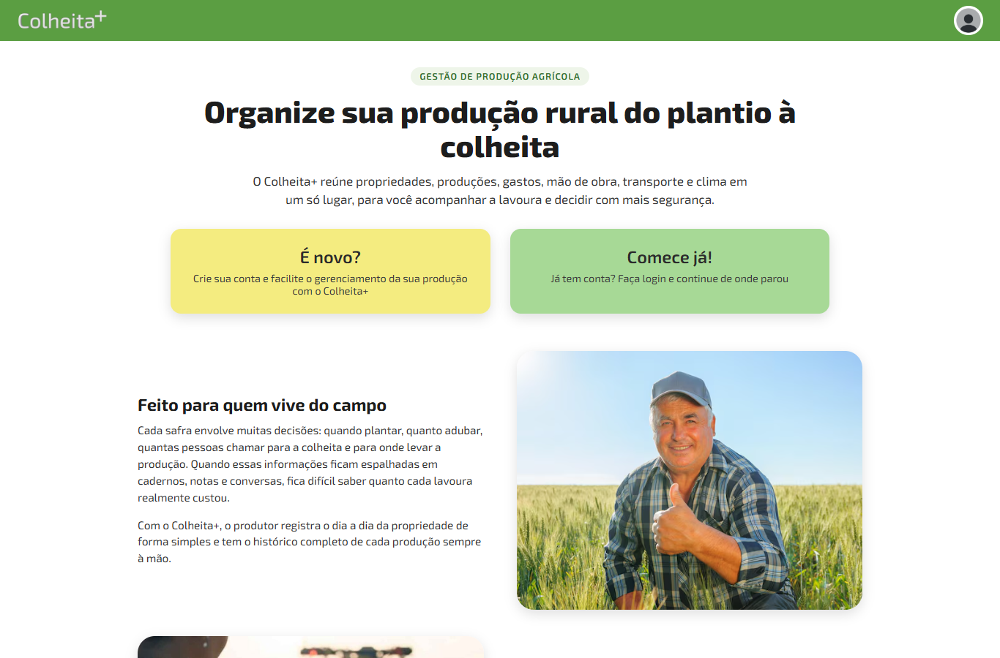
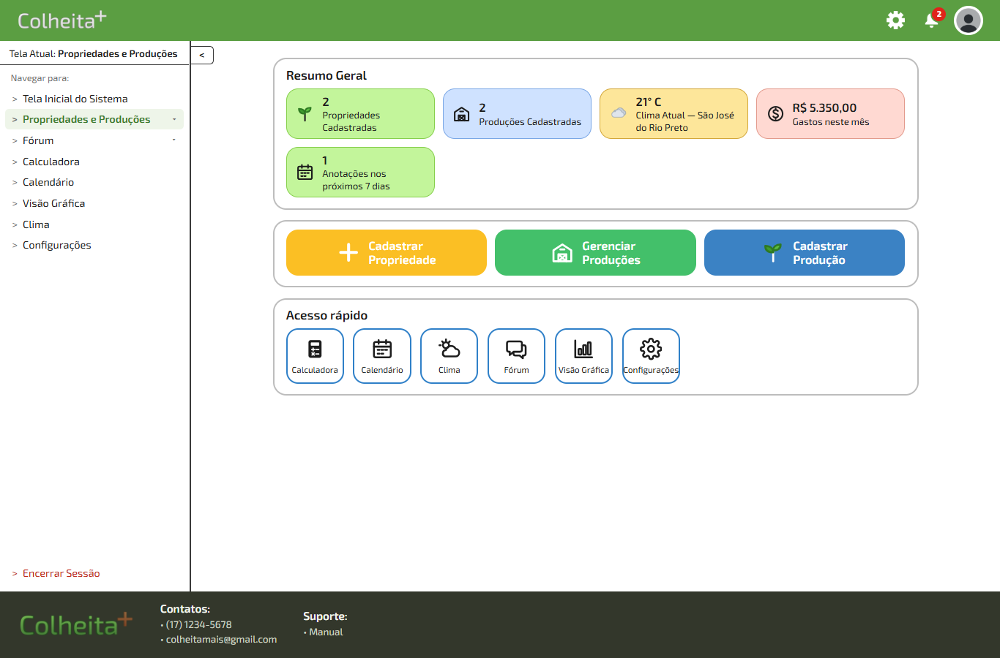
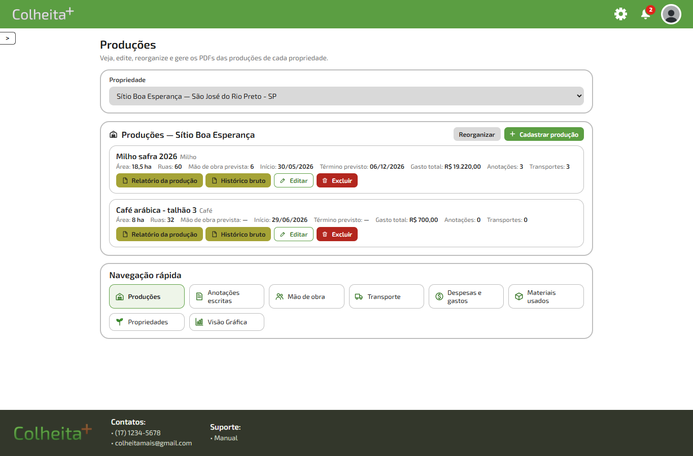
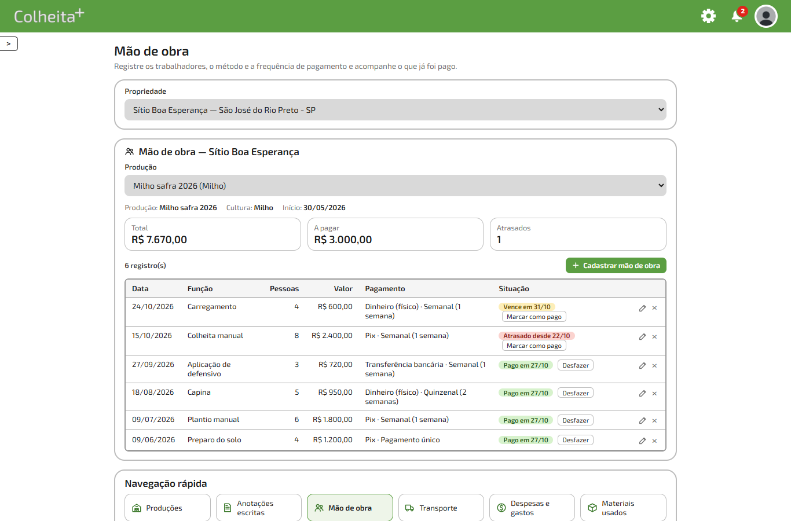
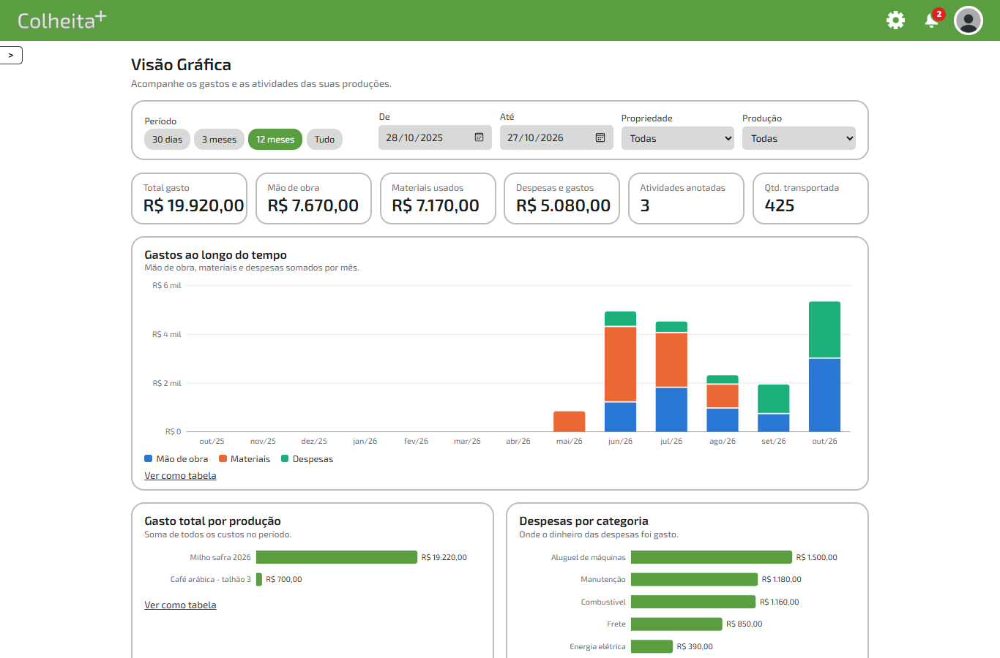
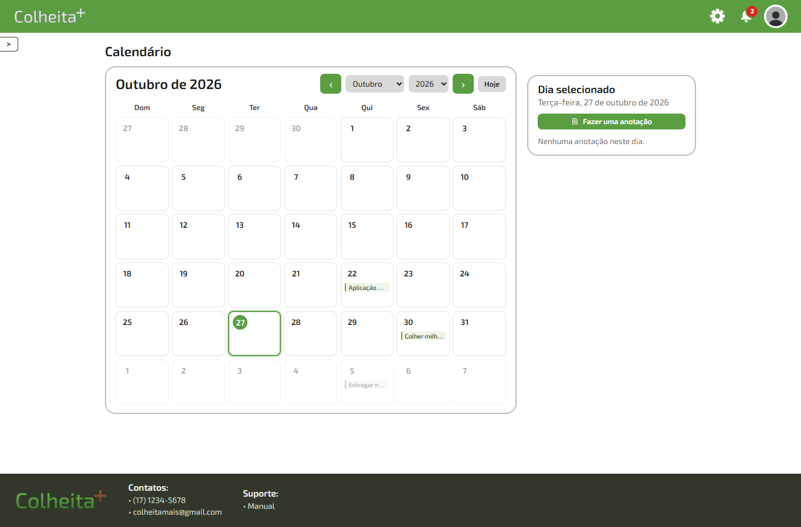
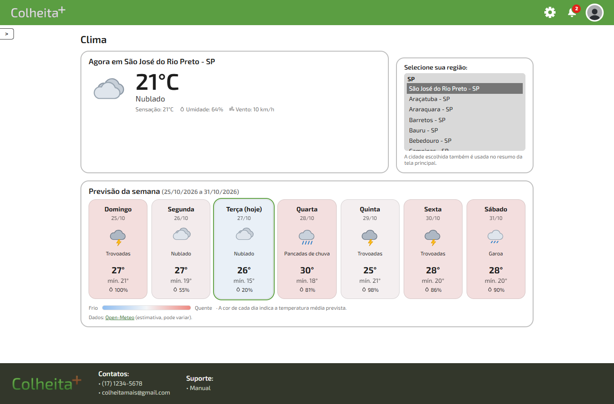
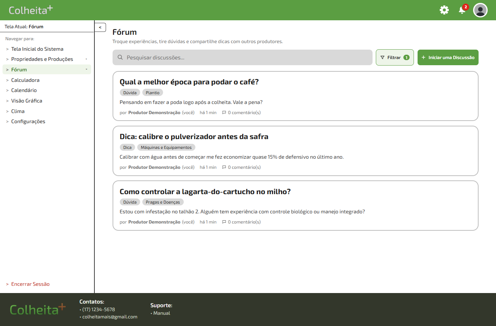
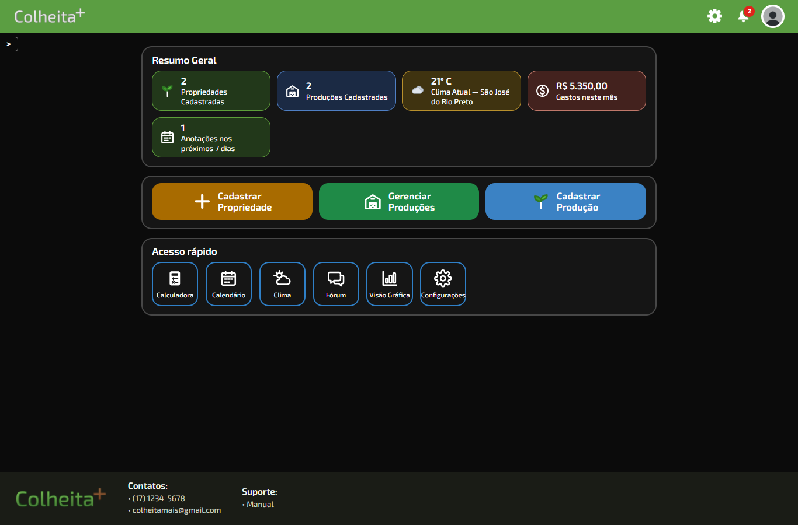

# 🌱 Colheita+ — Sistema de Gestão de Produção Agrícola

Sistema web para o produtor rural organizar **propriedades, produções, gastos, mão de obra, transporte e clima** em um só lugar, do plantio à colheita.

Projeto desenvolvido como **Trabalho de Conclusão de Curso (TCC)**.

**🔗 Acesse o sistema:** **https://colheita-mais.onrender.com**

> O site está no plano gratuito do Render: se ficar um tempo sem acessos, a primeira visita pode levar cerca de 50 segundos para carregar.


---

## 📸 Telas

| Página inicial | Painel do produtor |
|---|---|
|  |  |

| Produções e relatórios em PDF | Mão de obra e pagamentos |
|---|---|
|  |  |

| Visão Gráfica | Calendário |
|---|---|
|  |  |

| Clima da semana | Fórum entre produtores |
|---|---|
|  |  |

<p align="center"><b>Modo escuro</b><br></p>

*(Prints feitos com uma conta de demonstração e dados fictícios.)*

---

## ✨ Funcionalidades

- **Propriedades e produções** — cadastro, edição, exclusão e reorganização. Cada produção guarda cultura, área plantada, ruas, mão de obra prevista e datas.
- **Gestão completa da produção**, uma tela para cada função:
  - **Anotações escritas** das atividades feitas, salvas com data e hora;
  - **Mão de obra**, com método de pagamento (Pix, dinheiro físico, transferência…), frequência (semanal, quinzenal, mensal…), prazo e situação (pago, a vencer, atrasado);
  - **Transporte**, **Despesas e gastos** (por categoria) e **Materiais usados** (sementes, adubos, defensivos…).
- **Relatórios em PDF** — relatório resumido dos últimos 30 dias e histórico completo de toda a produção.
- **Visão Gráfica** — gastos por mês, por produção e por categoria, com filtros de período, propriedade e produção, e opção de ver cada gráfico como tabela.
- **Calendário** — anotações por dia, com avisos automáticos ("Faltam 3 dias para…", "Hoje é o dia de…").
- **Notificações** — eventos do calendário, pagamentos de mão de obra vencidos e comentários nas suas discussões do fórum.
- **Clima** — condição atual e previsão de domingo a sábado para dezenas de cidades, com dados da [Open-Meteo](https://open-meteo.com).
- **Fórum** — discussões com tags, busca, filtros e comentários; o criador pode editar, trancar ou excluir a sua discussão.
- **Calculadora** no estilo da calculadora do Google, funcionando também pelo teclado.
- **Acessibilidade** — modo escuro, zoom da tela, texto em negrito, alto contraste, espaçamento de leitura, destaque do foco pelo teclado, redução de animações e leitura em voz alta.
- **Rascunhos automáticos** — o que o produtor está digitando continua lá se ele sair da tela e voltar.
- Layout responsivo, funciona no computador e no celular.

---

## 🛠️ Tecnologias

| Parte | Tecnologia |
|---|---|
| Servidor | Node.js + Express |
| Banco de dados | PostgreSQL (`pg`) |
| Login e sessão | `express-session` + `connect-pg-simple` (sessão salva no banco), senhas com `bcryptjs` |
| PDFs | PDFKit |
| Interface | HTML, CSS e JavaScript puros (sem frameworks), fonte Exo 2, gráficos em SVG próprios |
| Clima | API Open-Meteo |
| Hospedagem | Render (site + PostgreSQL) |

---

## 🔒 Segurança

- Senhas guardadas com **hash bcrypt**, nunca em texto puro.
- Login por cookie assinado, com a sessão guardada no próprio PostgreSQL; em produção o cookie só trafega por HTTPS.
- Todas as telas internas exigem login. Cada usuário só acessa as próprias propriedades, produções, registros e notificações.
- Senhas e segredos ficam fora do código: localmente em `config.local.js` (não versionado) e, na hospedagem, em variáveis de ambiente.

---

## 💻 Como rodar no seu computador

**Pré-requisitos:** [Node.js](https://nodejs.org) 18 ou superior e [PostgreSQL](https://www.postgresql.org/download/) instalado.

1. Instale as dependências:
   ```bash
   npm install
   ```
2. Crie o arquivo `config.local.js` na raiz do projeto com os dados do seu PostgreSQL:
   ```js
   module.exports = {
     db: { host: 'localhost', port: 5432, user: 'postgres', password: 'SUA_SENHA', database: 'colheita' },
     port: 3000,
     sessionSecret: 'troque-por-um-texto-longo-e-aleatorio',
   };
   ```
3. Crie o banco e as tabelas:
   ```bash
   npm run init-db
   ```
   O servidor também aplica o `db/schema.sql` sozinho ao iniciar, então bancos antigos são atualizados sem perder dados.
4. Inicie o servidor:
   ```bash
   npm start
   ```
5. Acesse <http://localhost:3000>.

---

## ☁️ Publicar no Render

O arquivo [`render.yaml`](render.yaml) já descreve o site e o banco, os dois no plano gratuito. No painel do Render, use **New → Blueprint**, escolha este repositório e confirme. O Render cria o banco, define `DATABASE_URL` e `SESSION_SECRET` e publica o site. A cada novo envio para a branch `main`, o site é atualizado automaticamente.

---

## 📁 Estrutura

```
server.js              servidor Express, login, perfil e propriedades
config.js              lê as configurações (config.local.js ou variáveis de ambiente)
render.yaml            configuração de hospedagem no Render
routes/
  producoes.js         produções e registros (anotações, mão de obra, materiais, despesas, transporte)
  relatorios.js        relatórios em PDF
  calendario.js        calendário e notificações
  forum.js             fórum
  graficos.js          dados da Visão Gráfica e do resumo do painel
  util.js              autenticação e validações
db/
  schema.sql           tabelas do banco
  pool.js              conexão com o PostgreSQL
  init.js              cria o banco local (npm run init-db)
public/
  *.html               telas do sistema
  css/style.css        estilos, tema claro/escuro e acessibilidade
  js/                  scripts das telas
  assets/              imagens, ícones e fontes
docs/img/              prints usados neste README
scripts/               utilitários para rodar o servidor local no Windows
```

---

## 👤 Autor

Desenvolvido por [@gabriel-herran](https://github.com/gabriel-herran).
